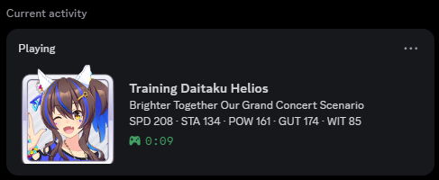
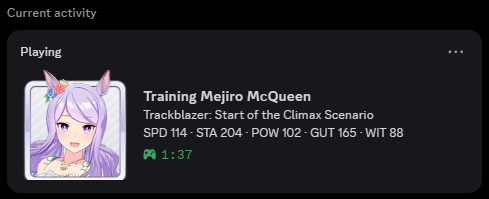

# HorseGirlRPC

A Hachimi plugin that shows live Umamusume career in Discord Rich Presence.

## Preview

**Da Wei**



**Also works with Alt Costume**



## Features

- Current Trainee name and training scenario
- Live Speed, Stamina, Power, Guts, and Wit stats
- Dynamic large Trainee icon for the active costume
- Energy and Mood display on Trainee icon hover (1.1.0)
- Menu display (1.1.0)

## Compatibility & Testing

Only tested on the **Global Steam** Version.
Idk if it works on **Japanese Steam/DMM** tho, also idk if it can display Trainee that's not released on Global yet

## Installation

1. Build or download from [Releases](https://github.com/BeLfayza/horse-girl-rpc/releases).
2. Copy it to the game's `hachimi` directory, for example:

   ```text
   UmamusumePrettyDerby/hachimi/horse_girl_rpc.dll
   ```

3. Add the DLL to `hachimi/config.json`:

   ```json
   {
     "load_libraries": [
       "hachimi\\horse_girl_rpc.dll"
     ]
   }
   ```

4. Restart the game with Discord running.

## Build

```powershell
cargo check
cargo build --release
```

## Credits

- [Umapyoi API](https://umapyoi.net/) — character and outfit metadata used to verify card/icon mappings.
- [Umamusume Wiki](https://umamusu.wiki/) — source of character icon images.
- [Hachimi](https://github.com/Hachimi-Hachimi/Hachimi) and [Hachimi Edge](https://github.com/kairusds/Hachimi-Edge) — plugin/mod loader and integration environment.

HorseGirlRPC is an independent fan project and is not affiliated with or endorsed by these projects or Cygames.